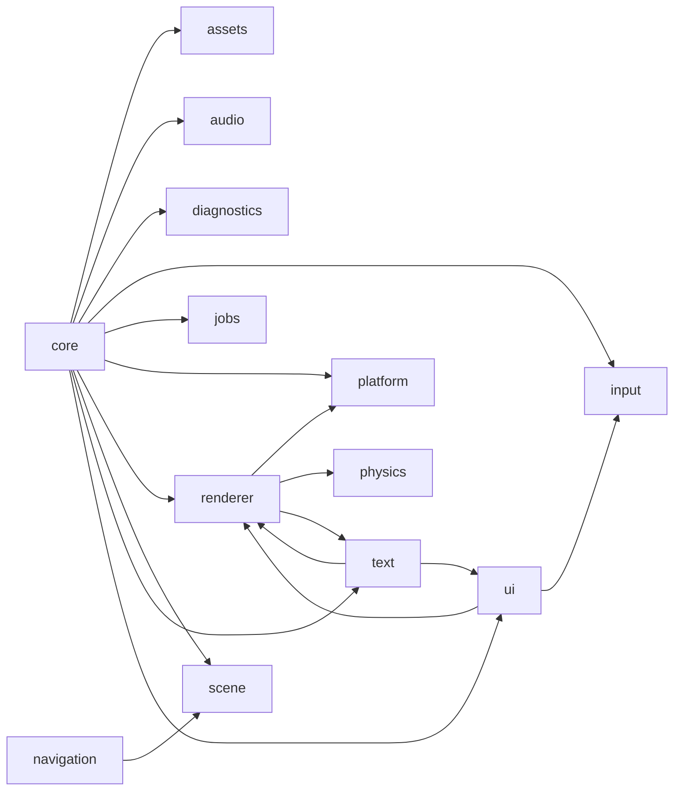

# Bairava Engine — Architecture Audit Action Items

**Audit reference:** First-pass static review of `main` at commit `52f60b42c3e38c883799753bbf452f80ed346552` (`culling`, 2026-11-20).

**Purpose:** Identify unnecessary module coupling, decisions that restrict game developers, resource-lifetime problems, scalability limits, and weaknesses in the public API.

> This is an action plan, not a statement that every item is a confirmed defect. Validate each finding against current code and tests before changing the architecture. The initial review was static and did not include a complete import-graph analysis or runtime profiling.

## Priority summary

| Priority | Area | Goal |
|---|---|---|
| High | Renderer/backend separation | Keep renderer-facing APIs independent of concrete backend implementations where practical. |
| High | Resource lifetime and scene ownership | Let games manage resource residency and release resources safely. |
| Medium | `Context` responsibilities | Avoid making `Context` an unnecessarily broad service locator. |
| Medium | Capacity and failure policies | Make limits visible and choose deliberate overflow behavior. |
| Medium | Public API usability | Ensure a game can be built using only the supported public API. |

---

## 1. Module dependency audit

- [x] Generate an import/dependency graph for all Zig modules under `src/engine/`.
- [x] Identify circular dependencies and report the exact import paths involved.
- [x] Identify modules with unusually high fan-in or fan-out; review whether they have too many responsibilities.
- [x] Identify dependencies that cross unrelated subsystems (for example, navigation depending on rendering).
- [x] Identify direct SDL/SDL_GPU imports outside the platform and backend layers.
- [x] Check whether core algorithms can compile and run without SDL or a GPU.
- [x] Record each confirmed coupling issue with source locations, impact, and a proposed boundary.

**Files to begin with:**

- `src/engine/core/context.zig`
- `src/engine/core/lifecycle.zig`
- `src/engine/renderer/sprite.zig`
- `src/engine/renderer/texture.zig`
- `src/engine/renderer/backends/sdl_gpu/`
- `src/engine/platform/`

**Review rule:** Broad dependencies are acceptable in composition-root code such as lifecycle/startup. Subsystems should not depend on unrelated subsystems without a clear reason.

**Validated result at audit time:** The engine contained 147 Zig modules and 480 local file-import edges. Excluding the test-only `testing/fixtures.zig`, the production graph had 146 modules, 469 edges, and no cycles. The test-helper cycles were:

- `renderer/sprite.zig` → `renderer/backends/sdl_gpu/backend.zig` → `renderer/backends/sdl_gpu/texture.zig` → `assets/loaders/image.zig` → `testing/fixtures.zig` → `renderer/sprite.zig`.
- `assets/loaders/image.zig` → `testing/fixtures.zig` → `renderer/texture.zig` → `assets/loaders/image.zig`.
- `renderer/backends/sdl_gpu/backend.zig` → `renderer/backends/sdl_gpu/texture.zig` → `assets/loaders/image.zig` → `testing/fixtures.zig` → `renderer/texture.zig` → `renderer/backends/sdl_gpu/backend.zig`.

These cycles pass through imports used by tests in `assets/loaders/image.zig`; the test suite compiles and passes. The previous production cycle between `animation/animation.zig` and `animation/machine.zig` was removed by extracting `animation/timeline.zig`.

The composition hubs are `core/engine.zig` (55 outgoing local imports) and `core/context.zig` (34). They are composition/API facades; no evidence showed a subsystem should be split solely to reduce fan-out. The largest incoming counts are `renderer/texture.zig` (18), `platform/types.zig` (17), and `logging/log.zig` (16). `navigation` imports `scene/tilemap.zig` for map data and does not depend on renderer code. Renderer modules reach SDL_GPU through `renderer/backends/sdl_gpu/`; direct SDL calls remain in the platform/backend boundary. `core/math.zig` uses cglm, and image, UI, logging, and script modules use their respective C libraries; these are not SDL imports.



The full test suite runs without opening a window or GPU device, covering CPU-side physics, collision, navigation, AI, replay, and renderer preparation. Renderer-device replacement and startup still require the supported runtime path.

## 2. Renderer and backend separation — High priority

- [x] Trace the complete dependency path from `SpriteBatch` and `Texture` to SDL_GPU and SDL3 2D.
- [x] Determine which parts of sprite batching, sorting, vertex preparation, and texture metadata can be independent of the GPU backend.
- [x] Decide whether Bairava intends to support multiple interchangeable rendering backends, or only one primary backend with platform-specific presentation support.
- [x] Decide that a backend interface is not warranted until a second complete renderer is a real goal.
- [x] Keep backend-specific types out of game-facing public APIs.
- [x] Add CPU-only tests for renderer preparation and ordering where GPU access is unnecessary.
- [x] Document backend-specific capabilities and unsupported behavior.
- [x] Assess whether a replacement/fake backend is meaningful with the current single-backend support.

**Validated result:** SDL_GPU is the only complete renderer. SDL3 2D is reserved/incomplete, so a replaceable-renderer contract or fake implementation would be speculative. Sprite ordering and CPU preparation are testable independently, while GPU resource creation and submission remain behind the SDL_GPU backend. No backend-specific SDL types are re-exported by the public `bairava` module. The replacement prototype is intentionally not built; necessary integration points for a second renderer are `core/lifecycle.zig`, `core/context.zig`, `renderer/renderer.zig`, `renderer/sprite.zig`, `renderer/texture.zig`, `renderer/post.zig`, `renderer/glyph_atlas.zig`, and backend/platform modules. These are renderer integration points, not unrelated gameplay dependencies.

**Starting locations:**

- `src/engine/renderer/sprite.zig`
- `src/engine/renderer/texture.zig`
- `src/engine/renderer/renderer.zig`
- `src/engine/renderer/backends/sdl_gpu/`
- `src/engine/platform/`

**Known point to verify:** `Texture` contains SDL_GPU state and SDL3 2D texture state, while `SpriteBatch` calls the SDL_GPU backend directly. Determine whether this is an acceptable single-engine implementation detail or an obstacle to the intended backend strategy.

## 3. Resource lifetime and scene ownership — High priority

- [x] Inventory all resource types and document who creates, owns, retains, releases, and destroys each one.
- [x] Trace asset lifetimes across scene push, pop, switch, and shutdown.
- [x] Confirm which asset types can be unloaded before engine shutdown.
- [x] Decide whether scenes should hold resource handles or scene-scoped asset references.
- [x] Evaluate early unloading for directly loaded textures, atlases, fonts, and sounds.
- [x] Define resource residency policies for assets that must persist across scene transitions.
- [x] Check whether memory budgets include decoded staging data, CPU copies, and GPU allocations.
- [x] Test failed loads, partial initialization, scene replacement, stale handles, and shutdown ordering.
- [x] Add tests that verify resources are released exactly once and are not destroyed while queued work still references them.

**Starting locations:**

- `docs/ownership.md`
- `src/engine/assets/manager.zig`
- `src/engine/assets/cache.zig`
- `src/engine/core/context.zig`
- `src/engine/core/lifecycle.zig`
- `src/engine/scene/scene_manager.zig`
- `src/engine/text/font_store.zig`

**Known point to verify:** The ownership documentation says named texture handles can be unloaded early, while directly loaded textures, atlases, fonts, and sounds remain until the run ends. The scene manager also documents that scene-loaded assets remain in memory after the scene closes.

**Validated result:** The ownership guide now distinguishes game-owned direct resources, counted texture handles, and store-owned font handles; it also states that the asset arena retains freed blocks until shutdown and that no aggregate budget exists. Context-aware teardown lets scenes release session-owned font handles safely. Semkootru releases its font during scene teardown and uses `errdefer` for partial initialization. Scene pop, replace, and manager shutdown paths have release-once coverage. Device-loss recovery remains explicitly unsupported.

## 4. `Context` responsibilities — Medium priority

- [x] Inventory every field and public method on `Context`.
- [x] For each method, identify the subsystem that owns the underlying behavior.
- [x] Identify call sites where a subsystem takes `Context` but only needs one small service or capability.
- [x] Decide which dependencies should be passed as narrower interfaces or explicit parameters.
- [x] Keep `Context` as the convenient game-facing facade where that convenience is valuable.
- [x] Avoid splitting `Context` merely to reduce line count; split only where it improves testing, ownership, or API clarity.
- [x] Add tests showing that selected subsystems can be used without constructing the full runtime context.

**Starting location:** `src/engine/core/context.zig`

**Questions:** Is `Context` becoming a service locator? Does adding a subsystem require unrelated modules to import it? Can independent systems be tested without a full `Context` fixture?

**Validated result:** `Context` is intentionally broad at the game/runtime boundary, but systems such as fixed-step simulation, physics, navigation, replay, and renderer preparation have standalone data/API tests. Startup and `Context` are composition roots; splitting them purely to lower their import counts would add indirection without a demonstrated caller.

## 5. Capacity, policy, and failure behavior — Medium priority

- [x] Search the engine for fixed capacities, limits, hardcoded defaults, panic paths, `catch unreachable`, and silent fallback behavior.
- [x] For every limit, record its value, memory/performance rationale, whether it is configurable, and what happens when it is reached.
- [x] Decide which limits should be configurable, queryable, or fixed implementation constraints.
- [x] Prefer explicit error/overflow results for recoverable runtime conditions; reserve panics for broken invariants or programmer errors.
- [x] Ensure limits and failure behavior are documented in the public API.
- [x] Add boundary tests for exactly-at-limit and over-limit behavior.

**Search terms:**

```text
max_
capacity
@panic
std.debug.panic
catch unreachable
hardcoded
```

**Known points to verify:**

- Sprite lighting has fixed per-frame limits for point lights and shadow segments; exceeding them panics.
- Audio declares a maximum of 32 simultaneous voices.
- Check whether these limits are exposed to callers and whether the overflow behavior is suitable for games.

**Validated result:** Lighting now skips overflow and returns acceptance/counts; its fixed limits are public and boundary-tested. The 32-voice limit and 8-scene depth are documented, with explicit errors when no voice or scene slot is available. The 256-name texture registry limit is public. Panics remain for programmer errors, impossible internal invariants, allocation failures in infallible APIs, and fixed-capacity misuse; they are not used as normal lighting overflow behavior.

## 6. Renderer capability and texture-format policy — Medium priority

- [x] Revisit `Context.stageFormats()` and its decision to disable ASTC, BC3, and BC1 variants.
- [x] Determine whether the restriction is still necessary while SDL3 2D is reserved/unavailable.
- [x] Decide whether format selection should depend on the active renderer, build configuration, or device capabilities.
- [x] Ensure the chosen policy does not create incompatible texture representations during backend switching.
- [x] Add tests for format selection and fallback behavior.
- [x] Document the trade-off between compression, memory use, load time, and renderer compatibility.

**Starting location:** `src/engine/core/context.zig` (`stageFormats`).

**Validated result:** Staging selects formats from the active GPU's capabilities while compressed representations remain disabled if renderer switching could make them unusable. RGBA8 remains the guaranteed fallback. The policy has a test and is described in `docs/platform-capabilities.md`.

## 7. Public API and caller-freedom audit — Medium priority

- [x] Start from `src/engine/bairava.zig` and `src/engine/core/engine.zig`; inventory what game code can access.
- [x] Identify useful capabilities available only through private engine modules.
- [x] Check whether public types expose SDL, GPU, or other implementation-specific types.
- [x] Identify defaults that callers cannot override and decide whether each is an intentional engine policy.
- [x] Check whether callers can provide custom policies or implementations where that is an intended extension point.
- [x] Check whether capacities are visible and whether their overflow behavior is controllable.
- [x] Identify assumptions that bias the engine toward one genre or the Semkootru sample game's design.
- [x] Build a small game using only the public `bairava` module; do not import private engine files.
- [x] Record every workaround, missing public capability, or engine modification needed by that game.
- [x] Turn recurring workarounds into candidate public APIs only when they represent general engine needs.

**Starting locations:**

- `src/engine/bairava.zig`
- `src/engine/core/engine.zig`
- `src/game/game.zig`
- `docs/api-compatibility.md`

**Validated result:** `sample` and the Semkootru game import only the named `bairava` module and compile with `zig build`. No public SDL/GPU type leaks were found. No recurring private-module workaround was identified; the public API version and documented fixed limits were synchronized after the lighting API change.

## 8. Change-impact and replaceability tests

- [x] Assess renderer replacement impact; record why a fake implementation is deferred.
- [x] Exercise the asset staging reader seam with a test reader and record the loader boundary.
- [x] Verify audio can be disabled or unavailable without breaking unrelated gameplay systems.
- [x] Run physics, collision, navigation, and AI tests without a window or GPU.
- [x] Verify a game can use the public API without depending on internal implementation details.
- [x] For the renderer and asset-loader seams, distinguish necessary integration changes from accidental coupling.

**Validated result:** Audio device failure is non-fatal and reported through `Capabilities`; audio APIs return `error.NoDevice`. The full CPU test suite and public-API sample build pass. Renderer replacement remains intentionally deferred: renderer modules and core lifecycle/context are necessary integration points, while gameplay code and the public API are not coupled to SDL types. Asset staging accepts a `Reader` interface, and its tests substitute `FakeFiles` for packaged file I/O; replacing that reader affects the platform file facade and context wiring, not parsers or cache semantics. Fonts/audio still use `Context.readFile` and require that same file-service boundary to change.

## 9. Performance and scalability questions

- [x] Add a deterministic workload with approximately 10,000 moving entities.
- [x] Add a deterministic workload with approximately 10,000 queued sprites.
- [x] Add a workload for large numbers of collision queries and moving colliders.
- [ ] Capture and record 10,000-entity/sprite runtime measurements on a supported display/GPU.
- [x] Look for hidden O(n²) paths in common update/draw operations.
- [x] Identify allocations in frequently executed code and determine whether they can be moved to setup or reused buffers.
- [x] Exercise behavior when asset and staging budgets reach their limits.
- [x] Verify the engine degrades gracefully when a workload exceeds a configured budget.
- [x] Ensure diagnostics let developers identify CPU, GPU, memory, and asset-loading bottlenecks.

**Progress:** The checked-in benchmark updates 10,000 deterministic moving game entities, rebuilds a broad-phase index for their moving colliders, performs 1,000 region queries per fixed update, and queues 10,000 sprites. It reports phase timings, entity/sprite counts, allocations, collision query/hit totals, and optional GPU timing. The initial Windows run initialized the runtime but did not produce the configured warm-up/sample summary, so no performance baseline is claimed; a faster local capture remains pending and timing requires a supported display/device. Sprite data grows geometrically and persists across frames after capacity is reached; the moving-collider index uses the frame allocator and is intentionally rebuilt each update. Cache/staging boundary tests verify eviction, over-budget referenced resources, staging deferral, and graceful failure. Static review found quadratic work only on uncommon bulk paths (repeated LRU victim scans and insertion-ordered `raycastAll` results); these are retained pending a measured bottleneck rather than optimized speculatively.

## 10. Reliability, determinism, and portability

- [x] Verify fixed-step simulation and replay determinism with repeatable test inputs.
- [x] Test malformed assets, scripts, and configuration data; confirm they fail safely with useful errors.
- [x] Test worker/main-thread handoff and resource access for races.
- [ ] Test startup failure at each initialization stage and verify cleanup.
- [x] Test scene transitions and shutdown while resources are in use.
- [x] Verify unsupported GPU/audio capabilities are reported clearly and handled according to policy.
- [ ] Check for Windows-only assumptions and verify platform-specific paths on Windows, Linux, and macOS.
- [x] Verify device-loss and GPU-resource recreation behavior; document unsupported recovery paths explicitly.

**Progress:** A fixed-step replay test records a repeatable 120-tick input sequence, replays a game-owned simulation twice, and compares its result. Existing asset, script, map, and settings tests reject malformed inputs. Concurrent staging tests race two worker jobs for a one-payload budget and verify one reservation succeeds, one is deferred, and the main thread releases the accepted payload. Scene release paths are tested for pop, replace, and shutdown. Startup uses `errdefer stop()` with per-resource success flags, but exhaustive per-stage injected-failure cleanup tests remain open. CI run `44723163170` passed the Windows, Linux, and macOS matrix on base commit `552d4c32`; it does not include this working-tree diff, so the latest changes still need platform-matrix results. Capability failures and the absence of SDL_GPU device-loss recovery are documented. This deterministic fixture does not establish determinism for the complete Semkootru game or provide a general replay format.

## 11. API usability and long-term maintainability

- [x] Review API naming and behavior consistency across subsystems.
- [x] Verify ownership and lifetime requirements are clear at each public API boundary.
- [x] Check that errors identify the failing asset, operation, or subsystem.
- [x] Confirm public API changes follow `docs/api-compatibility.md`.
- [x] Confirm save formats, animation formats, tile maps, and font formats have independent versioning rules.
- [x] Check dependency pins, source hashes, and license notices.
- [x] Verify documentation matches actual implementation and current supported behavior.
- [x] Verify CI exercises all supported platforms and relevant build profiles.
- [x] Identify obsolete compatibility code and decide when it can be removed safely.

**Progress:** API version 0.3.0 is synchronized across package metadata, source, and compatibility documentation. Saves, animation clips/machines/skeletons, maps, fonts, and audio formats have format-specific versions; the engine owns no general save-game format (the sample's save schema is separately versioned). Dependency commits/hashes, source-tree hashes, and license notices are recorded in the lock/policy and `scripts/check-dependency-pins.py` passes. Startup failures include subsystem, operation, and error; asset/audio loaders return operation-specific error categories, while the path remains the caller's argument and asynchronous texture logs include it. The CI workflow runs development/debug/release build profiles, asset checks, CLI probes, and tests on Windows, Linux, and macOS. A full API error-detail audit found no confirmed missing error category. The unused duplicate renderer shader module was removed; the BFNT compatibility adapter is retained intentionally.

---

## 12. Findings register

Use one entry per confirmed finding. Do not record a suspicion as a defect until it has supporting evidence.

| ID | Finding | Files / modules | Category | Severity | Evidence / reproduction | Impact | Proposed fix | Regression test | Status |
|---|---|---|---|---|---|---|---|---|---|
| ARCH-001 | Animation facade and state machine imported each other | `animation/animation.zig`, `animation/machine.zig` | Coupling | Low | Import graph had a cycle; timeline playback was shared across both modules | Import cycle complicated module boundaries | Extract `Timeline` to `animation/timeline.zig` | Animation tests; full build | Fixed |
| ARCH-002 | Unused renderer shader module duplicated the SDL_GPU backend shader path | `renderer/shader.zig`, `renderer/backends/sdl_gpu/` | Coupling | Low | Module had no callers and was the only direct SDL import outside platform/backend folders | Duplicated backend ownership and weakened boundary | Remove the unused duplicate module | Full build | Fixed |
| ARCH-003 | Scene teardown could not release session-owned font handles | `scene/scene_manager.zig`, `scene/host.zig`, `core/runtime.zig`, `game/game.zig` | Ownership | Medium | Scene `deinit` had no `Context`; Semkootru loaded a store-owned font | Font residency extended beyond scene lifetime | Add optional `deinitWithContext` and release the font at scene close | Scene pop/replace/shutdown tests | Fixed |
| ARCH-004 | Lighting overflow panicked despite being a recoverable per-frame capacity limit | `renderer/sprite.zig` | Policy | Medium | Filling fixed light/shadow uniform arrays reached panic paths | Content-heavy scenes could terminate the process | Return acceptance/counts, expose capacities, skip excess entries | Exact-capacity and overflow tests | Fixed |
| ARCH-005 | Test-only imports form cycles through the shared renderer fixtures | `assets/loaders/image.zig`, `testing/fixtures.zig`, `renderer/texture.zig`, `renderer/sprite.zig`, `renderer/backends/sdl_gpu/` | Coupling | Low | Three cycles are listed in section 1; each passes through an image test's `testing/fixtures.zig` import | Test graph is harder to reason about; production graph remains acyclic | If test compilation/import issues arise, move image-only compressed fixtures to a renderer-independent helper | Full test suite currently passes | Deferred; test-only |

### Severity guide

- **Critical:** Prevents intended engine use or risks data loss, corruption, or systemic failure.
- **High:** Blocks a major intended use case or makes subsystem replacement impractical.
- **Medium:** Creates recurring workarounds or restricts common game designs.
- **Low:** Primarily affects maintainability, consistency, or convenience.

**Accepted trade-offs / deferred work:** SDL_GPU remains the sole complete renderer; SDL3 2D is not a supported replacement target. Freed arena-backed asset memory is reclaimed at shutdown, and there is no aggregate asset budget. SDL_GPU device-loss recovery is unsupported and documented. Runtime performance results at 10,000 entities/sprites, cross-platform builds, race-focused resource tests, and full gameplay replay determinism were not established in this audit.

## 13. Suggested execution order

1. Complete the module dependency graph and public API inventory.
2. Review renderer/backend boundaries and `Context` responsibilities.
3. Audit ownership, resource residency, and scene transitions.
4. Inventory limits, hardcoded policies, panic paths, and fallback behavior.
5. Run public-API-only and change-impact prototypes.
6. Run scalability, reliability, determinism, and portability tests.
7. Prioritize confirmed findings, implement fixes, and add regression tests.
8. Repeat the audit after significant architectural milestones.

## Audit completion criteria

- [x] Every major engine subsystem appears in the dependency inventory.
- [x] Every confirmed high-severity finding has an owner, proposed fix, and regression test.
- [x] Public API usability has been demonstrated with a game that imports only the public engine module.
- [x] Resource ownership and scene-transition behavior are documented and tested.
- [x] Fixed capacities and failure policies are documented and boundary-tested.
- [ ] The current changes pass the supported-platform build and test matrix.
- [x] The final report distinguishes confirmed defects, accepted trade-offs, and deferred improvements.

**Completion status:** The dependency graph and API/resource/capacity decisions are recorded above. The full local test suite and default build pass, and the CI matrix passed on the base commit. Startup failure-injection tests, benchmark timing capture, and platform-matrix validation of this working-tree diff remain open; the audit is not complete until those items are exercised or formally accepted. Full-game determinism and SDL_GPU device-loss recovery remain explicitly out of scope.
